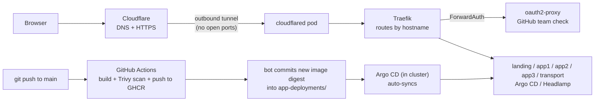

# xtemplate home lab

A small, always-on Kubernetes home lab running on an HP EliteDesk, serving a handful of self-built apps at
`*.xtemplate.cc`. Everything is built by GitHub Actions, deployed by Argo CD, and locked behind a GitHub
login.

> **Where this came from:** the repo started as a DevSecOps take-home challenge (a secured nginx
> "hello world" on a local kind cluster). It has since grown into a personal lab: the hello-world pages are
> gone, real apps have replaced them, and the cluster moved from kind on a laptop to k3s on a dedicated
> machine. Some leftovers from that first phase are noted under [Known gaps](#known-gaps--leftovers).

---

## What's running

| URL | What it is | Login? |
|---|---|---|
| `https://xtemplate.cc` | Landing page with links to everything below | No |
| `https://app1.xtemplate.cc` | Currency converter (React frontend + Express backend, live rates or a custom rate) | See [gaps](#known-gaps--leftovers) |
| `https://transport.xtemplate.cc` | Singapore bus & MRT arrivals (React frontend + Express backend; LTA DataMall + SMRT feed + CARTO map tiles; saved stops and target bus/train in the browser's localStorage) | No (public) |
| `https://architecture.xtemplate.cc` | Interactive architecture diagram of this lab (frontend only, static React build on nginx; content lives in `apps/architecture/src/data.js`) | No (public) |
| `https://app2.xtemplate.cc` | Local LLM chat (custom React UI + llama.cpp server, Qwen2.5-3B Q4) | Yes |
| `https://workout.xtemplate.cc` | Exercise tracker (assessment / training / ad-hoc modes, plans, stats; SQLite on a persistent volume) | Yes |
| `https://argocd.xtemplate.cc` | Argo CD UI | Yes |
| `https://console.xtemplate.cc` | Headlamp (cluster dashboard) | Yes |

"Login" means: you must sign in with GitHub **and** be a member of the `team-xtemplate` team in the
`team-jared` GitHub organisation. One login covers every subdomain (the cookie is shared across
`.xtemplate.cc`).

---

## How it fits together



**In plain words:**

1. **Getting in.** A visitor hits Cloudflare. Cloudflare passes the request down a tunnel that the
   `cloudflared` pod opened *from inside* the cluster, so the home router needs no port forwarding.
2. **Routing.** Traefik looks at the hostname (`workout.xtemplate.cc`, etc.) and picks the right app.
3. **Login check.** Before reaching a protected app, Traefik asks oauth2-proxy "is this person signed in
   and in the right GitHub team?" If not, they're sent to the GitHub login page.
4. **Deploying.** Pushing app code to `main` triggers that app's workflow. It builds the image, scans it,
   pushes it to GHCR, then commits the new image digest into the app's `deployment.yaml`. Argo CD notices
   the commit and rolls the change out. No `kubectl` from a laptop.

---

## The stack

| Layer | What's used | Notes |
|---|---|---|
| Hardware | HP EliteDesk 800 G4 Mini (i5-8500T, 16 GB RAM, 512 GB NVMe) | Hostname `xtemplatehomelab.local`, managed over SSH. Dual-boots Windows. |
| OS | Ubuntu | |
| Kubernetes | **k3s** (single node) | Installed with k3s's bundled Traefik **disabled**, so we run our own. |
| Ingress | Traefik (Helm) | Values in `platform/traefik-values.yaml`. Self-signed default cert (Cloudflare does the public HTTPS). |
| Auth | oauth2-proxy + Traefik ForwardAuth middlewares | GitHub OAuth app owned by the `team-jared` org. |
| Public access | Cloudflare Tunnel (`cloudflared` running as a pod) | Domain `xtemplate.cc` on Cloudflare DNS. |
| GitOps | Argo CD (Helm) | Apps created in the Argo CD UI, each pointing at a folder under `app-deployments/`. |
| CI | GitHub Actions | One reusable workflow, one small caller per image. |
| Registry | GHCR (`ghcr.io/xtemplate24/...`) | Images pinned by digest in the manifests. |
| Runtime scanning | Trivy Operator (Helm) | Daily rescans, results as `VulnerabilityReport` objects. No notifications (ntfy was dropped). |
| Storage | k3s `local-path` provisioner | Used by app3's SQLite volume. |

> **Coming from OpenShift?** A few rough equivalents: Traefik `Ingress` + `Middleware` ≈ an OpenShift
> `Route`; Cloudflare Tunnel replaces exposing a router to the internet; Pod Security `restricted` labels on
> namespaces ≈ the `restricted` SCC.

---

## Repository layout

| Path | What's in it |
|---|---|
| `apps/<app>/` | Source code + `Dockerfile` for each image (`landing`, `app1/{frontend,backend}`, `app2/{ui,llm}`, `app3/{frontend,backend}`, `transport/{frontend,backend}`, `architecture`) |
| `app-deployments/<app>/` | Kubernetes manifests (namespace, deployment, service, ingress, PVC). **This is what Argo CD watches.** |
| `platform/` | Cluster-wide pieces installed by hand: Helm values (Traefik, Argo CD, Trivy), `auth/` (oauth2-proxy + middlewares), `cloudflare/` (tunnel), `argocd/` and `headlamp/` ingresses |
| `.github/workflows/` | `build-image.yaml` (reusable template), one caller per image, `create-lockfile.yaml`, weekly `cleanup-registry.yaml` |
| `misc/DEPLOYMENT.md` | Step-by-step rebuild guide (written for the kind era; see note below) |
| `gitops/`, `cluster/kind-config.yaml` | Leftovers from the take-home phase, not used on k3s |

---

## CI/CD in detail

Each image has its own small workflow (e.g. `app3-backend-build.yaml`) that only runs when files in that
app's folder change. They all call the same template, `build-image.yaml`, which:

1. **Builds** the image locally on the runner (not pushed yet).
2. **Scans** it with Trivy for HIGH/CRITICAL issues that have a fix.
3. **Pushes** it to `ghcr.io/xtemplate24/<name>:<git-sha>`.
4. **Updates the manifest** (separate job): writes `image: ...@sha256:<digest>` into the app's
   `deployment.yaml` and commits it to `main` as `github-actions[bot]`.

Argo CD is set to auto-sync, so step 4 is what actually deploys.

Other workflows:

- **`create-lockfile.yaml`**: run by hand to generate a `package-lock.json` for a new Node app.
- **`cleanup-registry.yaml`**: every Sunday, keeps the 5 newest versions of each GHCR package and deletes
  the rest.

---

## Security notes

**Credentials**

- CI logs in to GHCR with the per-run `GITHUB_TOKEN` (short-lived, `packages: write` on the build job
  only). No stored registry secret.
- Only the manifest-update job gets `contents: write`, which it needs to push the digest commit.
- Secrets created by hand in the cluster, **never in git**:
  - `oauth2-proxy` in `auth` (GitHub client ID/secret + cookie secret)
  - `cloudflare-tunnel-secret` in `cloudflare` (tunnel token)
  - `transport-lta` in `transport` (LTA DataMall account key, optional)
  - `transport-carto` in `transport` (CARTO basemap key, optional)

**Workload hardening** (applied across the app deployments and oauth2-proxy)

- Namespaces enforce the Pod Security `restricted` level.
- Containers run as non-root, drop all capabilities, block privilege escalation, use seccomp
  `RuntimeDefault`, and have a read-only root filesystem (with an `emptyDir` at `/tmp` where needed).
- Service account tokens are not mounted; CPU/memory requests and limits are set.
- Images are pinned by digest, so what runs is exactly what was scanned.

**Scanning**

| Layer | Status | Catches | Misses |
|---|---|---|---|
| Build-time (Trivy in CI) | Running, but not blocking (see gaps) | Known CVEs at build time | Anything disclosed later |
| Runtime (Trivy Operator) | Running, daily | New CVEs in deployed images, including third-party ones | Misconfigured YAML before it's applied |
| Config scan (Trivy config / Checkov) | Not built | Risky settings in manifests | — |

**Exposure**

- Nothing on the home network is port-forwarded. The only way in is the Cloudflare tunnel.
- Everything except the landing page, `transport` and `architecture` (public by design) sits behind oauth2-proxy (with the app1 exception noted below).

---

## Everyday tasks

All commands are run on the EliteDesk over SSH (or anywhere with a kubeconfig for the cluster).

### Check that everything is healthy

```bash
kubectl get pods -A
```
Lists every pod in every namespace. Everything should be `Running` (or `Completed` for scan jobs).

```bash
kubectl get applications -n argocd
```
Shows each Argo CD app. You want `Synced` and `Healthy`.

### Change an app

Edit code under `apps/...`, commit, push to `main`. The pipeline builds it and Argo CD deploys it.

### Add a new app

1. Put the code and a `Dockerfile` in `apps/<name>/`.
2. Copy an existing caller workflow in `.github/workflows/` and point it at the new folder and manifest.
3. For a Node app, run the **create-lockfile** workflow once for the new folder.
4. Add manifests in `app-deployments/<name>/`: namespace, deployment, service, ingress. For a login-protected
   app, the ingress needs host `<name>.xtemplate.cc` and this annotation:
   ```yaml
   traefik.ingress.kubernetes.io/router.middlewares: auth-oauth2-proxy-errors@kubernetescrd,auth-oauth2-proxy-auth@kubernetescrd
   ```
5. In the Argo CD UI, create an Application pointing at `app-deployments/<name>/` with auto-sync on.
6. In the Cloudflare dashboard, add a published route for `<name>.xtemplate.cc` →
   `https://traefik.traefik.svc.cluster.local:443` with **No TLS Verify** turned on.

### See scan results

```bash
kubectl get vulnerabilityreports -A
```
One report per scanned container image, with counts by severity.

### Back up app3's data

app3 stores its SQLite file at `/data/app3.db` on a `local-path` volume on the EliteDesk's disk.

```bash
POD=$(kubectl get pod -n app3 -l app=app3-backend -o jsonpath='{.items[0].metadata.name}')
kubectl cp app3/$POD:/data/app3.db ./app3-backup-$(date +%F).db
```
The first line finds the backend pod's name; the second copies the database file out of it into the
current folder, with today's date in the name.

---

### The transport app (bus & MRT)

`transport.xtemplate.cc` is public, so it stores nothing on the server: saved stops/stations (up to 10
each) and the "target" bus/train live in each visitor's browser (`localStorage`). The backend only
forwards and caches upstream data (15 s per stop/station) and rate-limits each visitor.

| Data | Source | Key needed? |
|---|---|---|
| Bus stops + live bus arrivals | LTA DataMall (`v3/BusArrival`, `BusStops`) | Yes, free. Without it the app falls back to the community BusRouter feeds. |
| MRT disruption alerts | LTA DataMall (`TrainServiceAlerts`) | Yes |
| Live train times | SMRT's train-arrival feed (unofficial) | No. SMRT lines only: NSL, EWL, CCL, TEL, BPLRT |
| Map tiles | CARTO dark basemap (Leaflet), plus "Open in Google Maps" links | Yes, free (since Sept 2026). Without it the map falls back to standard OpenStreetMap tiles. |

Add the LTA key (get one at datamall.lta.gov.sg, "Request for API Access"):

```bash
kubectl create secret generic transport-lta -n transport --from-literal=account-key='YOUR_KEY'
kubectl rollout restart deployment/transport-backend -n transport
```
The first line stores the key as a Secret in the `transport` namespace; the second restarts the backend so
it picks the key up.

Add the CARTO map key (free at carto.com/basemaps/apikey; restrict it to `transport.xtemplate.cc`):

```bash
kubectl create secret generic transport-carto -n transport --from-literal=basemap-key='YOUR_KEY'
kubectl rollout restart deployment/transport-frontend -n transport
```

---

## Rebuilding from scratch

`misc/DEPLOYMENT.md` walks through the full rebuild (OAuth app, secrets, oauth2-proxy, Cloudflare tunnel,
Argo CD, Trivy). It was written for kind, so on k3s swap these steps:

- **Instead of `kind create cluster`**, install k3s with its bundled Traefik turned off:
  ```bash
  curl -sfL https://get.k3s.io | INSTALL_K3S_EXEC="--disable traefik" sh -
  ```
  Then copy `/etc/rancher/k3s/k3s.yaml` to `~/.kube/config` so `kubectl` works as your user.
- **Label the node** so our Traefik values (which select `ingress-ready=true`) can schedule:
  ```bash
  kubectl label node $(hostname) ingress-ready=true
  ```
- **Skip `kubectl apply -f gitops/`**. Create the Argo CD Applications in the UI instead.
- **Argo CD UI**: apply `platform/argocd/argocd-ingress.yaml` and add an `argocd.xtemplate.cc` tunnel route
  instead of port-forwarding.
- **Trivy Operator**: install without the `--set operator.webhookBroadcastURL=...` line (no ntfy).

---

## Known gaps / leftovers

Things worth fixing, roughly in order of importance:

- **app1's ingress has no auth middleware.** `app-deployments/app1/frontend/ingress.yaml` is missing the
  `router.middlewares` annotation that app2/app3 have, so app1 may be reachable without logging in.
- **The CI Trivy step doesn't block.** `build-image.yaml` sets `exit-code: "0"`, so a vulnerable image is
  reported but still pushed. Set it to `"1"` to make it a real gate.
- **`cloudflared` uses the `:latest` tag**, unlike everything else, which is pinned by digest.
- **Stale take-home files:** `gitops/` still defines the old `hello-nginx` / `second-page` apps, and
  `cleanup-registry.yaml` still lists their packages. `cluster/kind-config.yaml` is kind-only.
- **No network policies** yet; any pod can talk to any other pod.
- **Self-signed cert at Traefik.** Fine behind Cloudflare (traffic to the tunnel is encrypted), but the
  tunnel routes need **No TLS Verify**.
- **No branch protection on `main`**, because the pipeline pushes digest commits directly. The cleaner
  option is having the bot open a PR instead.
- **Backups are manual.** app3's data lives on the internal NVMe only.

---

## Roadmap

- Use the 4 TB Seagate portable drive as attached storage for the cluster and for backups (maybe Plex later).
- **app4**: a small custom app to control a smart bulb on the home network (instead of Home Assistant).
- Learn **Kafka** and **Redis** with a simulated scenario running in the lab.
- Give app2 a bigger/better model, ideally running on a GPU instead of CPU.
- Remote access to the box via Tailscale.